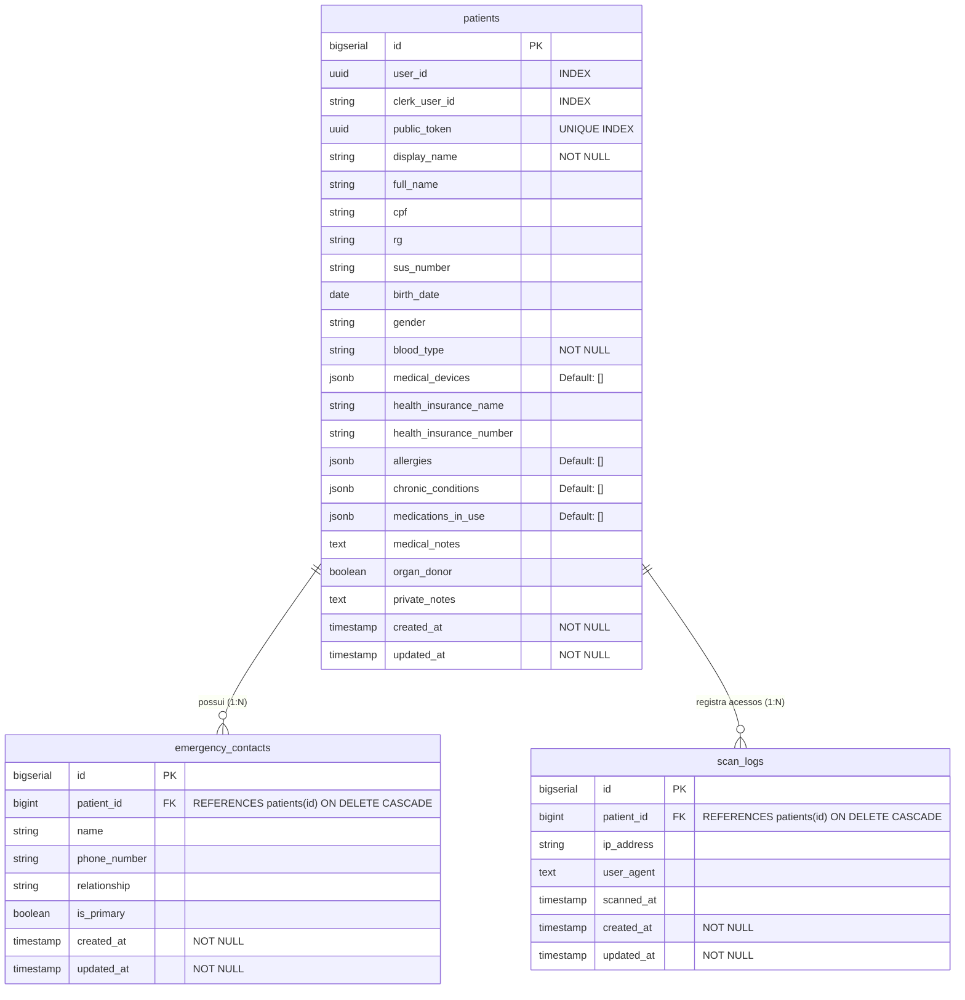

# Especificação Técnica do Backend - SOSqr (Rails 8 API RESTful)

Documento técnico de consolidação da arquitetura, modelagem de dados, regras de negócio, diretrizes de privacidade (LGPD), contratos de API e suíte de testes da API RESTful **SOSqr**.

---

## 1. Visão Geral e Arquitetura

### 1.1 Propósito do Sistema
O **SOSqr** é uma plataforma para gestão e visualização imediata de dados vitais e contatos de emergência via QR Code em cartão físico para qualquer indivíduo. O sistema provê uma API RESTful de alta performance, disponibilidade e estrita observância à privacidade para:
- Gerenciamento completo de prontuários médicos, dados vitais de emergência e contatos de socorro por cuidadores, familiares ou pelo próprio titular.
- Consulta instantânea e pública da ficha médica de socorro através da leitura de QR Code físico (em cartões padrão CR80, pulseiras ou chaveiros) por socorristas (SAMU, bombeiros, equipes de emergência e terceiros).
- Auditoria silenciosa de acessos a cada escaneamento de emergência com registro de IP e User-Agent (`scan_logs`).
- Painel administrativo com métricas agregadas e trilha de auditoria para monitoramento de saúde do ecossistema.
- Conformidade com a **LGPD (Lei Geral de Proteção de Dados - Lei nº 13.709/2018)**, balanceando a tutela da saúde e socorro imediato com o isolamento rigoroso de dados civis sensíveis contra fraudes.

### 1.2 Diagrama Arquitetural de Alto Nível

```mermaid
flowchart TD
    subgraph Frontend / Clientes
        A[Dashboard Cuidador / Web React]
        B[Socorrista / Leitor QR Code Mobile]
        ADM[Painel Administrativo / Web React]
    end

    subgraph Provedor de Identidade e Dados
        C[Supabase Auth\n(JWT ES256 / HS256 / Session)]
        DB[(Supabase PostgreSQL 16+\nRow Level Security RLS\nSession Pooler 5432 & pgcrypto)]
    end

    subgraph Backend - sosqr-api Rails 8
        D[ApplicationController\nFiltro JWT: JWKS ES256, Secret HS256 ou Fallback Auth API]
        D_ADMIN[Admin::BaseController\nValidação de Claim role: admin ou ADMIN_*_IDS]
        E[Api::V1::PatientsController\nCRUD Autenticado do Cuidador]
        F[Api::V1::EmergencyProfilesController\nFicha Pública via public_token]
        G_ADMIN[Api::V1::Admin::DashboardController\nKPIs Agregados, Scans Hoje & Auditoria com IP Mascarado]
        H[ScanLog Recorder\nAuditoria Silenciosa e Resiliente de Leituras]
    end

    A -- "1. Login / Obter JWT ES256/HS256" --> C
    A -- "2. Header: Authorization Bearer JWT" --> D
    D -- "3. Valida JWKS/Secret & extrai sub/id" --> E
    E -- "4. CRUD isolado por user_id" --> DB

    B -- "Leitura QR Code: GET /api/v1/emergency/:public_token" --> F
    F -- "Grava telemetria silenciosa (não-bloqueante)" --> H
    H --> DB
    F -- "Retorna dados vitais de socorro + SUS (LGPD Safe)" --> B

    ADM -- "1. Header: Bearer JWT com role admin" --> D_ADMIN
    D_ADMIN -- "2. Verifica claims de role ou ADMIN_*_IDS" --> G_ADMIN
    G_ADMIN -- "3. Retorna KPIs, scans_today e IPs mascarados" --> DB
```

### 1.3 Stack Tecnológica

| Componente | Tecnologia | Versão / Detalhes | Justificativa Técnica |
| :--- | :--- | :--- | :--- |
| **Linguagem** | Ruby | `3.3.5` (`.ruby-version`) | Alta performance com YJIT e estabilidade moderna. |
| **Framework** | Ruby on Rails | `8.1.3` (Modo API) | `config.api_only = true`: elimina overhead de views/cookies/assets para latência mínima. |
| **Banco de Dados** | PostgreSQL no Supabase | `16+` com `pgcrypto` & `RLS` | Banco gerenciado com RLS em todas as tabelas, Session Pooler (porta 5432) e conexões unificadas para `primary`, `cache`, `queue` e `cable` com `sslmode: require`. |
| **Servidor de Aplicação**| Puma | `6.x` | Servidor concorrente multithread configurado em modo single (`workers 0`, via `WEB_CONCURRENCY=0`) para otimização de memória (< 512MB) no Render/contêineres. |
| **Autenticação** | Supabase Auth | JWT ES256 / HS256 | Autenticação gerenciada compatível com padrão BaaS (suporte a JWKS ES256, Secret HS256 e validação direta via `/auth/v1/user`), sem armazenamento de senhas locais na API. |
| **Suíte de Testes** | RSpec & FactoryBot | `rspec-rails ~> 7.x`, `factory_bot_rails` | Testes automatizados BDD e mocks de integração declarativos. |

### 1.4 Dependências Críticas (`Gemfile`)

- **`jwt`**: Decodificação e validação criptográfica de tokens ES256 (via JWKS) e HS256 emitidos pelo Supabase Auth.
- **`dotenv-rails (~> 3.2)`**: Gerenciamento e injeção de variáveis de ambiente locais (`.env`) em desenvolvimento e testes.
- **`rack-cors`**: Configuração de Cross-Origin Resource Sharing liberando requisições assíncronas do frontend web/mobile (`ALLOWED_ORIGINS`).
- **`json (~> 2.8)`**: Compatibilidade de parsing JSON no ecossistema Rails 8 e Ruby 3.3.
- **`pg (~> 1.1)`**: Driver nativo do PostgreSQL para Active Record conectando ao Supabase via `DATABASE_URL`.

---

## 2. Autenticação, Segurança e Conformidade LGPD

### 2.1 Integração com Supabase Auth (ES256, HS256 e Fallback API)
A autenticação de usuários e administradores é 100% stateless e baseada em tokens JWT emitidos pelo **Supabase Auth**. Não há persistência de senhas ou hashes Bcrypt no banco de dados da API Rails.

Como o Supabase Auth moderno utiliza o algoritmo assimétrico de curva elíptica **ES256** (ECDSA P-256) por padrão para novos projetos, além do algoritmo simétrico tradicional **HS256**, a API Rails implementa um fluxo de verificação em camadas robusto e resiliente com tolerância a desvio de relógio (*clock leeway* de 120s):

#### Fluxo de Validação no `ApplicationController`:
1. O cliente (React/Vite) envia o token no cabeçalho HTTP:
   ```http
   Authorization: Bearer <supabase_access_token>
   ```
2. O filtro `before_action :authenticate_user!` intercepta todas as rotas privadas (com alias `authenticate_clerk_user!` para compatibilidade regressiva):
   - Extrai o token do cabeçalho. Caso ausente:
     - Em ambiente `development`: injeta usuário de fallback `@current_user_id = 'dev_cuidador_local'` com role `admin` para permitir testes rápidos sem bloquear o fluxo.
     - Em produção: responde imediatamente com `401 Unauthorized`.
   - **Camada 1 - Tokens Assimétricos (ES256 / RS256 via JWKS)**:
     - Identifica o cabeçalho JWT (`alg`).
     - Se `ES256` ou `RS256`, valida a assinatura criptográfica contra as chaves públicas oficiais do projeto Supabase obtidas dinamicamente do endpoint `https://<SUPABASE_PROJECT_ID>.supabase.co/auth/v1/.well-known/jwks.json` (`JWT::JWK::Set`).
   - **Camada 2 - Tokens Simétricos (HS256 via Secret)**:
     - Se `SUPABASE_JWT_SECRET` estiver configurado, valida a assinatura com algoritmo `HS256` (suportando tanto o formato em texto puro quanto a chave em base64 decodificada) com tolerância de 120s.
   - **Camada 3 - Fallback Oficial Direto via API do Supabase**:
     - Caso a validação local das camadas anteriores falhe, a API realiza uma requisição HTTPS direta e síncrona ao endpoint oficial `GET https://<SUPABASE_PROJECT_ID>.supabase.co/auth/v1/user` com o token e a `SUPABASE_ANON_KEY`, obtendo o perfil autenticado diretamente do provedor com timeout estrito de 4s.
   - **Extração de Identidade e Privilégios**:
     - Extrai o identificador único do usuário a partir das claims `sub` ou `id`, atribuindo a `@current_user_id`.
     - Extrai a role administrativa a partir de `payload.dig('app_metadata', 'role')`, `payload.dig('user_metadata', 'role')`, `payload['role']`, ou por correspondência de ID com as variáveis `ADMIN_USER_IDS`, `ADMIN_SUPABASE_IDS` ou `ADMIN_CLERK_IDS`.
   - Em caso de falha irreversível de verificação, registra log de advertência estruturado e responde com status `401 Unauthorized`.

```ruby
# app/controllers/application_controller.rb
require 'net/http'
require 'json'
require 'jwt'

class ApplicationController < ActionController::API
  before_action :authenticate_user!

  attr_reader :current_user_id, :claims, :jwt_claims, :current_user_role

  private

  def authenticate_user!
    header = request.headers['Authorization']
    token = header.split(' ').last if header.present?

    # 1. Se não houver token no cabeçalho
    unless token
      if Rails.env.development?
        @current_user_id = 'dev_cuidador_local'
        @current_user_role = 'admin'
        return
      else
        return render json: { error: 'Token de autenticação não fornecido' }, status: :unauthorized
      end
    end

    # 2. Decodificação e Validação do Token
    decoded = decode_token(token)

    @claims = decoded[0] || {}
    @jwt_claims = @claims
    @current_user_id = @claims['sub'].presence || @claims['id'].presence || 'dev_cuidador_local'
    @current_user_role = @claims.dig('app_metadata', 'role') ||
                         @claims.dig('user_metadata', 'role') ||
                         @claims['role'] ||
                         (Rails.env.development? ? 'admin' : nil)
  rescue JWT::DecodeError, JWT::ExpiredSignature => e
    Rails.logger.warn "[AUTH ERROR] Falha na validação do token JWT: #{e.class} - #{e.message}"
    render json: { error: 'Token inválido ou expirado', details: e.message }, status: :unauthorized
  rescue StandardError => e
    Rails.logger.error "[AUTH UNEXPECTED ERROR] #{e.class} - #{e.message}"
    render json: { error: 'Erro ao validar autenticação', details: e.message }, status: :internal_server_error
  end

  def decode_token(token)
    header = begin
      JSON.parse(Base64.urlsafe_decode64(token.split('.').first))
    rescue StandardError
      {}
    end
    alg = header['alg'] || 'HS256'

    # 1. Se o token for assimétrico (ES256 / RS256 gerado pelo Supabase moderno)
    if %w[ES256 RS256].include?(alg)
      begin
        return JWT.decode(token, nil, true, { algorithms: %w[ES256 RS256], jwks: supabase_jwks, leeway: 120 })
      rescue StandardError => e
        Rails.logger.warn "[JWKS VERIFY FAILED] #{e.message}. Tentando validação via API Supabase..."
      end
    end

    # 2. Se o token for simétrico (HS256) com o JWT Secret do Supabase
    if ENV['SUPABASE_JWT_SECRET'].present?
      secret = ENV['SUPABASE_JWT_SECRET'].to_s.strip.delete_prefix('"').delete_suffix('"')
      begin
        return JWT.decode(token, secret, true, { algorithm: 'HS256', leeway: 120 })
      rescue JWT::VerificationError => e
        begin
          return JWT.decode(token, Base64.decode64(secret), true, { algorithm: 'HS256', leeway: 120 })
        rescue StandardError
          Rails.logger.warn "[HS256 VERIFY FAILED] #{e.message}. Tentando validação via API Supabase..."
        end
      end
    end

    # 3. Fallback definitivo: Validação oficial direta com a API do Supabase (/auth/v1/user)
    api_claims = validate_with_supabase_api(token)
    return api_claims if api_claims.present?

    # 4. Modo desenvolvimento
    if Rails.env.development?
      return [JWT.decode(token, nil, false)[0] || { 'sub' => 'dev_cuidador_local' }, {}]
    end

    raise JWT::DecodeError, "Assinatura do token (#{alg}) não pôde ser verificada."
  end

  def supabase_jwks
    @supabase_jwks ||= begin
      project_id = ENV.fetch('SUPABASE_PROJECT_ID', 'gqonewnyyjaxwubqxhjg')
      uri = URI("https://#{project_id}.supabase.co/auth/v1/.well-known/jwks.json")
      response = Net::HTTP.get(uri)
      JWT::JWK::Set.new(JSON.parse(response))
    end
  end

  def validate_with_supabase_api(token)
    project_id = ENV.fetch('SUPABASE_PROJECT_ID', 'gqonewnyyjaxwubqxhjg')
    uri = URI("https://#{project_id}.supabase.co/auth/v1/user")
    req = Net::HTTP::Get.new(uri)
    req['Authorization'] = "Bearer #{token}"
    anon_key = ENV['SUPABASE_ANON_KEY'] || ENV['VITE_SUPABASE_ANON_KEY']
    req['apikey'] = anon_key if anon_key.present?

    http = Net::HTTP.new(uri.host, uri.port)
    http.use_ssl = true
    http.open_timeout = 4
    http.read_timeout = 4
    res = http.request(req)

    if res.is_a?(Net::HTTPSuccess)
      user_data = JSON.parse(res.body)
      [{
        'sub' => user_data['id'],
        'email' => user_data['email'],
        'role' => user_data['role'],
        'app_metadata' => user_data['app_metadata'] || {},
        'user_metadata' => user_data['user_metadata'] || {}
      }, { 'alg' => 'SUPABASE_API' }]
    else
      nil
    end
  rescue StandardError => e
    Rails.logger.warn "[SUPABASE AUTH API EXCEPTION] #{e.message}"
    nil
  end

  alias_method :authenticate_clerk_user!, :authenticate_user!
end
```

### 2.2 Proteção Anti-IDOR e Row Level Security (RLS) no PostgreSQL
O sistema implementa defesa em profundidade (Defense-in-Depth) contra Insecure Direct Object Reference (IDOR):

1. **Acesso Público de Emergência via UUID v4:**
   - O QR Code **nunca** expõe chaves sequenciais primárias (`/patients/1`, `/patients/2`).
   - O acesso público é realizado estritamente pelo campo `public_token` (UUID v4 de 128 bits gerado via `SecureRandom.uuid`).
   - O espaço de endereçamento de $2^{122}$ combinações inviabiliza ataques de enumeração ou varredura em massa.
   - O campo conta com restrição de unicidade no banco de dados (`index_patients_on_public_token UNIQUE`).

2. **Isolamento de Escopo por Cuidador na API Rails (Active Record):**
   - Nas operações privadas (`/api/v1/patients`), toda consulta é vinculada estritamente ao `@current_user_id` validado pelo token:
     ```ruby
     @patient = Patient.where(id: params[:id])
                       .where("user_id = :uid OR clerk_user_id = :uid", uid: @current_user_id)
                       .first!
     ```
   - Caso um usuário tente acessar ou alterar um `id` pertencente a outro cuidador, a busca dispara `ActiveRecord::RecordNotFound`, respondendo `404 Not Found` sem revelar a existência do registro.

3. **Camada de Defesa em Banco via Row Level Security (RLS):**
   - Habilitado nativamente no Supabase PostgreSQL via migration `EnableRlsOnAllTables`.
   - Garante que mesmo em eventuais consultas diretas via PostgREST/Supabase client, um usuário só consegue visualizar e modificar dados pertencentes ao seu `auth.uid()`:
     ```sql
     CREATE POLICY "Cuidadores gerenciam seus proprios pacientes"
     ON public.patients FOR ALL TO authenticated
     USING (auth.uid()::text = user_id OR auth.uid()::text = clerk_user_id)
     WITH CHECK (auth.uid()::text = user_id OR auth.uid()::text = clerk_user_id);
     ```

### 2.3 Diretriz de Privacidade e Conformidade LGPD
O sistema trata **Dados Pessoais Sensíveis** (Art. 5º, II da LGPD: saúde, biomédicos e diretivas) e **Dados Pessoais Civis** (Art. 5º, I: nome, CPF, RG).

Para cumprir os princípios de **Finalidade, Adequação e Necessidade** (Art. 6º, I, II e III da LGPD) combinados com a **Tutela da Saúde e Proteção da Vida** (Art. 7º, VII e Art. 11, II, "f" da LGPD), há uma divisão arquitetural estrita entre a ficha pública do socorrista e a ficha de gestão privada:

| Atributo do Modelo | Tipo de Dado | Exposto no QR Code de Emergência? | Exposto na Gestão do Usuário? | Justificativa Técnica e LGPD |
| :--- | :--- | :---: | :---: | :--- |
| `display_name` | Nome Social / Exibição | **Sim** | **Sim** | Identificação humanizada imediata no socorro. |
| `full_name` | Nome Civil Completo | **Sim** | **Sim** | Confirmação inequívoca da identidade civil do indivíduo pela equipe médica/socorrista. |
| `age` | Inteiro (método auxiliar) | **Sim** | **Sim** | Determinação imediata de dosagens e conduta médica apropriada à faixa etária. |
| `birth_date` | Data de Nascimento | **Sim** | **Sim** | Validação de prontuário hospitalar e confirmação etária. |
| `gender` | Gênero / Sexo | **Sim** | **Sim** | Direcionamento de protocolos clínicos no atendimento pré-hospitalar. |
| `blood_type` | Fator Sanguíneo | **Sim** | **Sim** | Dado vital emergencial para transfusão imediata em choque hemorrágico. |
| `medical_devices` | Lista (`jsonb`) | **Sim** | **Sim** | Alerta crítico para marcapasso (evita choque convencional), próteses e implantes. |
| `health_insurance_name` | Operadora do Convênio | **Sim** | **Sim** | Direcionamento ágil para hospital/pronto-socorro conveniado. |
| `health_insurance_number` | Matrícula do Convênio | **Sim** | **Sim** | Abertura ágil de ficha de urgência no hospital de destino. |
| `allergies` | Lista (`jsonb`) | **Sim** | **Sim** | Prevenção de choque anafilático fatal na administração de fármacos. |
| `chronic_conditions`| Lista (`jsonb`) | **Sim** | **Sim** | Orientação de conduta clínica (diabetes, cardiopatias, hipertensão, etc.). |
| `medications_in_use`| Lista (`jsonb`) | **Sim** | **Sim** | Prevenção de interações medicamentosas graves (anticoagulantes, insulina, sedativos). |
| `medical_notes` | Texto Livre | **Sim** | **Sim** | Recomendações clínicas emergenciais adicionais (alergias de contato, restrições). |
| `organ_donor` | Booleano | **Sim** | **Sim** | Expressão da diretiva antecipada de vontade do titular. |
| `emergency_contacts`| Sub-recurso (1:N) | **Sim** | **Sim** | Comunicação imediata com familiares e responsáveis durante o socorro. |
| `cpf` | Documento Federal | **NÃO** | **Sim** | **Protegido:** Previne fraudes financeiras, abertura indevida de contas e clonagem civil. |
| `rg` | Documento Estadual | **NÃO** | **Sim** | **Protegido:** Identificação civil mantida em sigilo estrito fora da emergência. |
| `sus_number` | Cartão Nacional SUS (CNS) | **Sim** | **Sim** | Identificador oficial do sistema público de saúde para triagem rápida em UPAs, prontos-socorros e regulação médica do SAMU (Tutela da Saúde - Art. 7º, VII da LGPD). Sanitizado para 15 dígitos. |
| `private_notes` | Anotações Privadas | **NÃO** | **Sim** | **Protegido:** Informações de rotina confidencial, nunca expostas no QR Code. |
| `user_id` | Identificador Supabase | **NÃO** | **NÃO (interno)** | UUID do cuidador no Supabase Auth (`sub`), chave de isolamento de dados. |
| `clerk_user_id` | Identificador Legado | **NÃO** | **NÃO (interno)** | Chave de compatibilidade retroativa para contas migradas. |

---

## 3. Modelagem de Dados e Esquema de Banco

### 3.1 Diagrama Entidade-Relacionamento (ERD)



### 3.2 Dicionário de Tabelas e Atributos

#### Tabela `patients`
Armazena o prontuário completo do indivíduo, dados vitais, dados civis restritos e parametrizações de socorro.

| Coluna | Tipo SQL | Modificadores / Índices | Descrição |
| :--- | :--- | :--- | :--- |
| `id` | `bigint` | Primary Key, Auto Increment | Identificador interno sequencial do paciente. |
| `user_id` | `varchar` / `uuid` | `index: true` | Identificador do usuário/cuidador no Supabase Auth (claim `sub`). |
| `clerk_user_id` | `varchar` | `index: true` | Identificador de transição/legado de contas migradas. |
| `public_token` | `uuid` | `unique: true`, `index: true` | Token público UUID v4 impresso no QR Code de emergência. |
| `display_name` | `varchar` | `null: false` | Nome de exibição/social (fallback automático via callback). |
| `full_name` | `varchar` | Opcional | Nome civil completo do titular. |
| `cpf` | `varchar` | Opcional | CPF do titular (restrito ao usuário/cuidador autenticado). |
| `rg` | `varchar` | Opcional | Registro Geral civil e órgão emissor. |
| `sus_number` | `varchar` | Opcional | Cartão Nacional de Saúde (CNS/SUS, sanitizado para 15 dígitos numéricos). |
| `birth_date` | `date` | Opcional | Data de nascimento (utilizada no cálculo do método `age`). |
| `gender` | `varchar` | Opcional | Gênero/sexo (`Feminino`, `Masculino`, etc.). |
| `blood_type` | `varchar` | `null: false` | Tipo sanguíneo e fator Rh (`A+`, `O-`, etc.). |
| `medical_devices` | `jsonb` | `default: []` | Lista de dispositivos, próteses ou implantes (ex.: Marcapasso). |
| `health_insurance_name` | `varchar` | Opcional | Nome da operadora do plano de saúde/convênio. |
| `health_insurance_number` | `varchar` | Opcional | Número da carteirinha ou matrícula do plano de saúde. |
| `allergies` | `jsonb` | `default: []` | Array JSON de alergias medicamentosas e alimentares. |
| `chronic_conditions`| `jsonb` | `default: []` | Array JSON de condições crônicas preexistentes. |
| `medications_in_use`| `jsonb` | `default: []` | Array JSON de medicamentos de uso contínuo e posologias. |
| `medical_notes` | `text` | Opcional | Observações clínicas vitais adicionais para socorristas. |
| `organ_donor` | `boolean` | Opcional | Declaração de doador de órgãos. |
| `private_notes` | `text` | Opcional | Informações confidenciais de acesso exclusivo ao titular/cuidador. |
| `created_at` | `timestamp` | `null: false` | Timestamp de criação do registro. |
| `updated_at` | `timestamp` | `null: false` | Timestamp da última atualização. |

#### Tabela `emergency_contacts`
Contatos telefônicos de familiares ou responsáveis a serem acionados em caso de resgate.

| Coluna | Tipo SQL | Modificadores / Índices | Descrição |
| :--- | :--- | :--- | :--- |
| `id` | `bigint` | Primary Key, Auto Increment | Identificador interno do contato. |
| `patient_id` | `bigint` | Foreign Key `patients(id)`, `null: false`, `index: true` | Referência ao paciente proprietário do contato. |
| `name` | `varchar` | Opcional | Nome da pessoa de contato. |
| `phone_number` | `varchar` | Opcional | Número de telefone/WhatsApp com DDD. |
| `relationship` | `varchar` | Opcional | Grau de parentesco/vínculo (ex: "Filho(a)", "Cônjuge", "Médico(a)"). |
| `is_primary` | `boolean` | Opcional | Define se é o contato prioritário de acionamento imediato. |
| `created_at` | `timestamp` | `null: false` | Timestamp de criação. |
| `updated_at` | `timestamp` | `null: false` | Timestamp de atualização. |

#### Tabela `scan_logs`
Trilha de auditoria e telemetria gravada a cada leitura da ficha de emergência.

| Coluna | Tipo SQL | Modificadores / Índices | Descrição |
| :--- | :--- | :--- | :--- |
| `id` | `bigint` | Primary Key, Auto Increment | Identificador interno do log de leitura. |
| `patient_id` | `bigint` | Foreign Key `patients(id)`, `null: false`, `index: true` | Referência ao paciente escaneado. |
| `ip_address` | `varchar` | Opcional | Endereço IP do socorrista no momento do scan. |
| `user_agent` | `text` | Opcional | Header `User-Agent` (dispositivo/browser utilizado na leitura). |
| `scanned_at` | `timestamp` | Opcional | Data e hora exata da leitura do QR Code. |
| `created_at` | `timestamp` | `null: false` | Timestamp de inserção no banco. |
| `updated_at` | `timestamp` | `null: false` | Timestamp de atualização. |

---

### 3.3 Políticas de Segurança de Nível de Linha (Row Level Security - RLS)

Todas as tabelas do schema público possuem RLS habilitado (conforme migration `20261023131500_enable_rls_on_all_tables.rb`), blindando a base de dados no Supabase:

1. **Tabela `patients`**:
   - `ENABLE ROW LEVEL SECURITY`: Ativo.
   - **Política**: `"Cuidadores gerenciam seus proprios pacientes"` (FOR ALL TO authenticated).
   - **Condição**: `(auth.uid()::text = user_id OR auth.uid()::text = clerk_user_id)`.
2. **Tabela `emergency_contacts`**:
   - `ENABLE ROW LEVEL SECURITY`: Ativo.
   - **Política**: `"Cuidadores gerenciam contatos de seus pacientes"` (FOR ALL TO authenticated).
   - **Condição**: Subconsulta verificando propriedade do `patient_id` correspondente ao `auth.uid()`.
3. **Tabela `scan_logs`**:
   - `ENABLE ROW LEVEL SECURITY`: Ativo.
   - **Política**: `"Cuidadores leem scan_logs de seus pacientes"` (FOR SELECT TO authenticated).
   - **Condição**: Subconsulta verificando propriedade do `patient_id` correspondente ao `auth.uid()`.
4. **Tabelas Internas do Rails (`schema_migrations`, `ar_internal_metadata`)**:
   - `ENABLE ROW LEVEL SECURITY`: Ativo. Garante aprovação integral pelo Supabase Security Advisor.
   - Como o backend Rails conecta com credencial superuser `postgres`, possui privilégio de superusuário (`BYPASSRLS`), mantendo migrações e rotas da API executadas normalmente.

---

### 3.4 Regras de Negócio e Implementação nos Modelos

#### `Patient` (`app/models/patient.rb`)
- **Associações em Cascata**:
  - `has_many :emergency_contacts, dependent: :destroy`
  - `has_many :scan_logs, dependent: :destroy`
- **Atributos Aninhados (Nested Attributes)**:
  - `accepts_nested_attributes_for :emergency_contacts, allow_destroy: true` — permite criação, edição e exclusão de contatos em uma única transação atômica.
- **Callbacks do Ciclo de Vida**:
  - `before_validation :ensure_display_name`: caso `display_name` seja omitido, extrai automaticamente o primeiro nome a partir de `full_name` (`full_name.to_s.strip.split(/\s+/).first`).
  - `before_validation :sanitize_sus_number`: remove qualquer caractere não numérico do campo `sus_number`.
  - `before_validation :sync_user_identifiers`: sincroniza bidirecionalmente `user_id` e `clerk_user_id` durante o período de migração caso um dos campos esteja preenchido.
  - `before_create :set_public_token`: inicializa o `public_token` usando `SecureRandom.uuid` se o atributo estiver vazio.
- **Métodos Auxiliares**:
  - `age`: Calcula dinamicamente a idade em anos inteiros com base em `birth_date` e `Date.current`, ajustando para o mês e dia de aniversário:
    ```ruby
    def age
      return nil if birth_date.blank?
      b_date = birth_date.is_a?(Date) ? birth_date : Date.parse(birth_date.to_s)
      today = Date.current
      calculated = today.year - b_date.year
      calculated -= 1 if today.month < b_date.month || (today.month == b_date.month && today.day < b_date.day)
      calculated
    rescue ArgumentError
      nil
    end
    ```
  - `last_scan`: Retorna os dados do último escaneamento associado a partir de `scan_logs`:
    ```ruby
    def last_scan
      last_log = scan_logs.max_by { |s| s.scanned_at || s.created_at }
      return nil unless last_log

      timestamp = last_log.scanned_at || last_log.created_at
      formatted = timestamp&.strftime("%d/%m/%Y %H:%M")
      {
        date: formatted,
        scanned_at: formatted,
        ip_address: last_log.ip_address,
        ip: last_log.ip_address
      }
    end
    ```
- **Validações**:
  - `validates :display_name, :blood_type, presence: true` assegura integridade mínima para situações de socorro.
  - `validates :sus_number, length: { is: 15 }, format: { with: /\A\d+\z/ }, allow_blank: true` valida conformidade com padrão CNS.

#### `EmergencyContact` (`app/models/emergency_contact.rb`)
- **Associações**:
  - `belongs_to :patient`

#### `ScanLog` (`app/models/scan_log.rb`)
- **Associações**:
  - `belongs_to :patient`

---

### 3.5 Povoamento de Dados e Seeds (`db/seeds.rb`)

A API conta com um script de povoamento realista e idempotente em `db/seeds.rb` (detalhado em `docs/GUIA_POVOAMENTO_BANCO_DADOS.md`), permitindo testar fluxos clínicos completos, contatos de emergência e histórico de escaneamentos:
- **Alvo Configurável**: Por padrão, associa os perfis ao usuário local `@current_user_id = 'dev_cuidador_local'`. Para vincular a um usuário real do Supabase em ambientes de homologação ou desenvolvimento conectado, basta definir a variável `TARGET_USER_ID`:
  ```bash
  TARGET_USER_ID="<uuid-do-usuario-no-supabase>" bin/rails db:seed
  ```
- **Dados Sintéticos Realistas**: Cadastra perfis com casos clínicos diversos (pediátricos, idosos com marcapasso, adultos com asma e alergias severas), contatos prioritários com telefones formatados e gera múltiplos registros de `scan_logs` retroativos com User-Agents móveis simulados (iOS Safari, Android Chrome, App SAMU) para alimentar os gráficos e a auditoria do Dashboard Admin.

---

## 4. Contratos e Especificação de Endpoints

### 4.1 Resumo dos Endpoints

| Método | Caminho | Autenticação / Permissão | Descrição | Status de Sucesso |
| :--- | :--- | :---: | :--- | :---: |
| `GET` | `/api/v1/emergency/:public_token` | **Pública** | Ficha vital de emergência (socorrista). Gera `ScanLog`. | `200 OK` |
| `GET` | `/api/v1/patients` | Bearer JWT (Usuário) | Lista perfis vinculados ao usuário logado com `age` e `last_scan`. | `200 OK` |
| `GET` | `/api/v1/patients/:id` | Bearer JWT (Usuário) | Prontuário detalhado com dados civis, médicos e contatos. | `200 OK` |
| `POST` | `/api/v1/patients` | Bearer JWT (Usuário) | Cadastra perfil com contatos aninhados e campos médicos. | `201 Created` |
| `PATCH/PUT` | `/api/v1/patients/:id` | Bearer JWT (Usuário) | Atualiza prontuário e contatos com suporte a `_destroy`. | `200 OK` |
| `DELETE` | `/api/v1/patients/:id` | Bearer JWT (Usuário) | Exclui perfil com deleção em cascata (`dependent: :destroy`). | `204 No Content` |
| `GET` | `/api/v1/admin/dashboard` | Bearer JWT (Role `admin`) | Agregações do sistema (KPIs) e histórico de 50 scans. | `200 OK` |

---

### 4.2 Detalhamento das Rotas

#### 4.2.1 `GET /api/v1/emergency/:public_token`
- **Descrição**: Rota pública acionada pelo socorrista ao ler o QR Code físico. Retorna estritamente dados médicos vitais de socorro, número do Cartão SUS e contatos para discagem rápida. Dispara a gravação silenciosa e resiliente de auditoria em `scan_logs`.
- **Autenticação**: Totalmente pública e isenta de autenticação (`skip_before_action :authenticate_user!, only: [:show], raise: false` e `skip_before_action :authenticate_clerk_user!, only: [:show], raise: false`).
- **Parâmetros de Rota**:
  - `public_token` (UUID v4 obrigatório): Token contido na URL do QR Code.
- **Efeito Colateral**: Insere um registro em `scan_logs` com `ip_address: request.remote_ip`, `user_agent: request.user_agent`, `scanned_at: Time.current` envolto em bloco não-bloqueante (`rescue StandardError`), garantindo que eventuais instabilidades na auditoria nunca impeçam o acesso emergencial do socorrista.
- **Tratamento de Exceções**: Captura `ActiveRecord::RecordNotFound` e `ActiveRecord::StatementInvalid`, retornando `404 Not Found`.
- **Respostas**:

##### 200 OK
```json
{
  "public_token": "cb11872a-8338-4119-8ca6-f14f7b77aace",
  "display_name": "Francisca",
  "full_name": "Maria Francisca dos Santos",
  "age": 42,
  "birth_date": "1984-05-10",
  "gender": "Feminino",
  "blood_type": "O+",
  "organ_donor": true,
  "sus_number": "898001234567890",
  "medical_notes": "Alergia severa a dipirona e anti-inflamatórios não-esteroidais.",
  "medical_devices": [
    "Marcapasso Cardíaco (Não desfibrilar convencionalmente)"
  ],
  "health_insurance_name": "Unimed Fortaleza",
  "health_insurance_number": "123456789-0",
  "allergies": [
    "Penicilina e Dipirona"
  ],
  "chronic_conditions": [
    "Hipertensão Arterial",
    "Diabetes Tipo 2"
  ],
  "medications_in_use": [
    "Losartana 50mg"
  ],
  "emergency_contacts": [
    {
      "name": "Carlos",
      "phone_number": "(85) 99123-4567",
      "relationship": "Irmão",
      "is_primary": true
    },
    {
      "name": "Mariana",
      "phone_number": "(85) 99234-5678",
      "relationship": "Esposa",
      "is_primary": false
    }
  ]
}
```

##### 404 Not Found (Token inexistente ou inválido)
```json
{
  "error": "Ficha de emergência não encontrada"
}
```

---

#### 4.2.2 `GET /api/v1/patients`
- **Descrição**: Retorna a lista de perfis vinculados exclusivamente ao usuário autenticado (`user_id == current_user_id || clerk_user_id == current_user_id`). Inclui o cálculo de idade (`age`), contatos de emergência e o resumo do último escaneamento (`last_scan`).
- **Autenticação**: Obrigatória (`Authorization: Bearer <token>`).
- **Respostas**:

##### 200 OK
```json
[
  {
    "id": 1,
    "user_id": "a1b2c3d4-e5f6-7890-abcd-ef1234567890",
    "clerk_user_id": "a1b2c3d4-e5f6-7890-abcd-ef1234567890",
    "public_token": "cb11872a-8338-4119-8ca6-f14f7b77aace",
    "display_name": "Francisca",
    "full_name": "Maria Francisca dos Santos",
    "cpf": "123.456.789-00",
    "rg": "1234567 SSP/CE",
    "sus_number": "898001234567890",
    "birth_date": "1984-05-10",
    "age": 42,
    "gender": "Feminino",
    "blood_type": "O+",
    "medical_devices": [
      "Marcapasso Cardíaco (Não desfibrilar convencionalmente)"
    ],
    "health_insurance_name": "Unimed Fortaleza",
    "health_insurance_number": "123456789-0",
    "allergies": ["Penicilina e Dipirona"],
    "chronic_conditions": ["Hipertensão Arterial"],
    "medications_in_use": ["Losartana 50mg"],
    "medical_notes": "Alergia severa a dipirona.",
    "organ_donor": true,
    "private_notes": "Chave reserva na portaria.",
    "created_at": "2026-09-14T10:00:00.000Z",
    "updated_at": "2026-09-14T10:00:00.000Z",
    "emergency_contacts": [
      {
        "id": 1,
        "patient_id": 1,
        "name": "Carlos",
        "phone_number": "(85) 99123-4567",
        "relationship": "Irmão",
        "is_primary": true,
        "created_at": "2026-09-14T10:00:00.000Z",
        "updated_at": "2026-09-14T10:00:00.000Z"
      }
    ],
    "last_scan": {
      "date": "14/09/2026 09:12",
      "scanned_at": "14/09/2026 09:12",
      "ip_address": "191.209.45.12",
      "ip": "191.209.45.12"
    }
  }
]
```

##### 401 Unauthorized (Token ausente ou inválido)
```json
{
  "error": "Token não fornecido"
}
```

---

#### 4.2.3 `GET /api/v1/patients/:id`
- **Descrição**: Retorna o prontuário completo de um perfil específico pertencente ao usuário autenticado.
- **Autenticação**: Obrigatória (`Authorization: Bearer <token>`).
- **Parâmetros de Rota**: `id` (bigint).
- **Respostas**:
  - `200 OK`: Retorna o objeto individual com a mesma estrutura de atributos civis e médicos de `GET /api/v1/patients`, incluindo `emergency_contacts`, `age` e `last_scan`.
  - `404 Not Found`:
    ```json
    {
      "error": "Paciente não encontrado ou acesso não autorizado"
    }
    ```

---

#### 4.2.4 `POST /api/v1/patients`
- **Descrição**: Cadastra um novo perfil, associando-o automaticamente ao `@current_user_id` e gerando seu `public_token` UUID v4. Suporta atributos aninhados de contatos de emergência (`emergency_contacts_attributes`) e os campos médicos/civis consolidados.
- **Autenticação**: Obrigatória (`Authorization: Bearer <token>`).
- **Cabeçalhos**: `Content-Type: application/json`.
- **Exemplo de Payload de Requisição**:
```json
{
  "patient": {
    "display_name": "Geraldo",
    "full_name": "Geraldo Alencar da Silva",
    "cpf": "987.654.321-11",
    "rg": "7654321 SSP/RJ",
    "sus_number": "700001234567890",
    "birth_date": "1985-11-20",
    "gender": "Masculino",
    "blood_type": "AB-",
    "organ_donor": false,
    "medical_devices": [
      "Aparelho auditivo bilateral"
    ],
    "health_insurance_name": "Bradesco Saúde",
    "health_insurance_number": "987654321",
    "allergies": [
      "Iodo",
      "Sulfas"
    ],
    "chronic_conditions": [
      "Asma"
    ],
    "medications_in_use": [
      "Salbutamol spray"
    ],
    "medical_notes": "Portador de asma moderada.",
    "private_notes": "Informações confidenciais.",
    "emergency_contacts_attributes": [
      {
        "name": "Ana Luiza",
        "phone_number": "+5521977776666",
        "relationship": "Esposa",
        "is_primary": true
      }
    ]
  }
}
```

- **Respostas**:
  - `201 Created`: Retorna o objeto do perfil cadastrado com `id`, `public_token`, `created_at` e `updated_at`.
  - `422 Unprocessable Entity`: Erros de validação (ex.: `Display name não pode ficar em branco`, `Blood type não pode ficar em branco`).

---

#### 4.2.5 `PATCH/PUT /api/v1/patients/:id`
- **Descrição**: Atualiza os dados cadastrais e médicos do perfil. Permite adicionar contatos (sem `id`), atualizar contatos existentes (passando `id`) ou remover contatos passando `id` e `_destroy: true`.
- **Autenticação**: Obrigatória (`Authorization: Bearer <token>`).
- **Respostas**:
  - `200 OK`: Retorna o objeto atualizado.
  - `422 Unprocessable Entity`: Falhas de validação.
  - `404 Not Found`: Caso o perfil não pertença ao usuário logado.

---

#### 4.2.6 `DELETE /api/v1/patients/:id`
- **Descrição**: Exclui o perfil do sistema, removendo em cascata todos os contatos de emergência e logs de escaneamento associados via `dependent: :destroy`.
- **Autenticação**: Obrigatória (`Authorization: Bearer <token>`).
- **Respostas**:
  - `204 No Content`: Exclusão executada com sucesso.
  - `404 Not Found`: Registro inexistente ou pertencente a outro usuário.

---

#### 4.2.7 `GET /api/v1/admin/dashboard`
- **Descrição**: Endpoint exclusivo para administradores da plataforma. Retorna KPIs agregados de monitoramento do sistema (incluindo acessos nas últimas 24 horas - `scans_today`) e a listagem dos últimos 50 escaneamentos de emergência auditados com proteção de privacidade.
- **Autenticação**: Obrigatória via Bearer JWT do Supabase Auth (suportando tanto tokens ES256 via JWKS quanto HS256 via secret).
- **Autorização**: Validação executada por `Api::V1::Admin::BaseController#require_admin!`:
  - Verifica claims administrativas no token: `app_metadata.role == 'admin'`, `user_metadata.role == 'admin'`, `role == 'admin'`, `metadata.role == 'admin'` ou `public_metadata.role == 'admin'`.
  - OU verifica se o `@current_user_id` está presente nas variáveis de ambiente `ADMIN_USER_IDS`, `ADMIN_SUPABASE_IDS` ou `ADMIN_CLERK_IDS`.
  - Retorna `403 Forbidden` com `{ "error": "Acesso não autorizado ao painel administrativo." }` se o usuário não possuir privilégios administrativos.
- **Privacidade e Proteção LGPD (`mask_ip`)**:
  - Para conformidade estrita com a LGPD, os endereços IP dos socorristas na listagem `recent_scans` são obrigatoriamente mascarados pelo backend (ex.: `191.209.***.***` ou `2001:0db8:****:****`), mitigando riscos de identificação geográfica desnecessária.
- **Exemplo de Resposta `200 OK`**:
```json
{
  "total_patients": 128,
  "total_scans": 1450,
  "total_caregivers": 94,
  "scans_today": 12,
  "kpis": {
    "total_patients": 128,
    "total_scans": 1450,
    "total_caregivers": 94,
    "scans_today": 12
  },
  "recent_scans": [
    {
      "id": 542,
      "patient_id": 1,
      "patient_name": "Maria Francisca dos Santos",
      "public_token": "cb11872a-8338-4119-8ca6-f14f7b77aace",
      "ip_address": "191.209.***.***",
      "user_agent": "Mozilla/5.0 (iPhone; CPU iPhone OS 17_4 like Mac OS X)",
      "scanned_at": "2026-09-21T08:15:30.000Z"
    }
  ]
}
```

- **Exemplo de Resposta `403 Forbidden`**:
```json
{
  "error": "Acesso não autorizado ao painel administrativo."
}
```

---

## 5. Auditoria e Logs de Emergência (`ScanLog`)

### 5.1 Fluxo de Gravação Silenciosa e Resiliente
A cada requisição no endpoint público `GET /api/v1/emergency/:public_token`, a aplicação executa o registro de telemetria de forma isolada e não-bloqueante:

```ruby
# app/controllers/api/v1/emergency_profiles_controller.rb
patient = Patient.includes(:emergency_contacts).find_by!(public_token: params[:public_token])

begin
  patient.scan_logs.create(
    ip_address: request.remote_ip,
    user_agent: request.user_agent,
    scanned_at: Time.current
  )
rescue StandardError => e
  Rails.logger.warn("[SOSqr] Falha não impeditiva ao registrar log de escaneamento: #{e.message}")
end
```
  scanned_at: Time.current
)
```

### 5.2 Propósitos e Benefícios da Telemetria
1. **Rastreabilidade e Segurança Jurídica**: Permite auditar quando, em qual horário e de qual IP a ficha foi consultada.
2. **Notificação em Tempo Real (Solid Queue & Realtime)**: Na evolução de mensageria assíncrona, a gravação servirá como evento/trigger para disparar alertas aos contatos prioritários (WhatsApp/SMS/Push: *"Atenção: A ficha de emergência de Maria Francisca acaba de ser acessada por um socorrista"*).
3. **Detecção de Anomalias e Scraping**: Identificação de acessos repetitivos ou tentativas de força bruta em tokens públicos.

---

## 6. Ambiente de Testes (RSpec)

### 6.1 Configuração do RSpec e FactoryBot
A suíte de testes utiliza `rspec-rails` com `FactoryBot::Syntax::Methods` habilitado globalmente em `spec/rails_helper.rb`.

#### Factory de Paciente Atualizada (`spec/factories/patients.rb`):
```ruby
FactoryBot.define do
  factory :patient do
    user_id { SecureRandom.uuid }
    clerk_user_id { "user_test_#{SecureRandom.hex(4)}" }
    display_name { "Francisca" }
    full_name { "Maria Francisca dos Santos" }
    cpf { "123.456.789-00" }
    rg { "1234567 SSP/CE" }
    birth_date { "1984-05-10" }
    gender { "Feminino" }
    blood_type { "O+" }
    organ_donor { true }
    medical_devices { ["Marcapasso Cardíaco"] }
    health_insurance_name { "Unimed Fortaleza" }
    health_insurance_number { "123456789-0" }
    allergies { ["Penicilina e Dipirona"] }
    chronic_conditions { ["Hipertensão Arterial"] }
    medications_in_use { ["Losartana 50mg"] }
    medical_notes { "Alergia severa a dipirona." }
    private_notes { "Chave reserva na portaria." }
  end
end
```

---

## 7. Variáveis de Ambiente e Configuração

O backend requer as seguintes variáveis configuradas no arquivo `.env` (ou no painel do Render/contêiner de produção):

```bash
# Conexão PostgreSQL direta ao Supabase via Session Pooler (porta 5432)
DATABASE_URL="postgresql://postgres.<project_ref>:<password>@aws-0-us-east-1.pooler.supabase.com:5432/postgres"

# Modo SSL do PostgreSQL (padrão em produção: require)
DB_SSLMODE=require

# Identificador do Projeto Supabase (utilizado na busca dinâmica de JWKS e fallback API)
SUPABASE_PROJECT_ID="gqonewnyyjaxwubqxhjg"

# Chave secreta de validação JWT do Supabase Auth (HS256 - string ou base64)
SUPABASE_JWT_SECRET="sua_supabase_jwt_secret_aqui..."

# Chave pública/anon do Supabase (utilizada no fallback da Auth API /auth/v1/user)
SUPABASE_ANON_KEY="eyJhbGciOiJIUzI1NiIsInR5cCI6IkpXVCJ9..."

# Lista de identificadores (UUIDs) autorizados para o painel administrativo
ADMIN_USER_IDS="00000000-0000-0000-0000-000000000000"
ADMIN_SUPABASE_IDS="00000000-0000-0000-0000-000000000000"

# Chave secreta de integridade de sessão do Rails (produção)
SECRET_KEY_BASE="gerar_via_bin_rails_secret_ou_automatico_no_render"

# Configuração de processos e threads do Puma
PORT=3000
RAILS_MAX_THREADS=5
WEB_CONCURRENCY=0 # Modo single process (0 workers) para não exceder 512MB RAM no Render

# Origens autorizadas no CORS (separadas por vírgula)
ALLOWED_ORIGINS="https://sosqr.vercel.app,http://localhost:5173"

# Ambiente Rails e nível de log
RAILS_ENV=production
RAILS_LOG_LEVEL=info
```

### 7.1 Deploy e Infraestrutura em Nuvem (Render Blueprint)
A aplicação está preparada para implantação com Dockerfile otimizado multi-stage em harmonia com o arquivo `render.yaml`:
- **Migrações Automáticas**: No script `entrypoint.sh`, a inicialização do contêiner executa `bundle exec rails db:migrate` com timeout estrito de 15 segundos para evitar travamentos decorrentes de poolers em espera.
- **Isolamento de Memória**: O Puma opera em modo single worker (`WEB_CONCURRENCY=0`), estabilizando o consumo em ~160MB de RAM e mantendo margem segura na camada gratuita do Render.
- **Healthcheck Nativo do Rails 8**: Monitoramento de integridade ativo na rota `/up`.

---

## 8. Evolução Arquitetural e Roadmap

1. **Background Jobs com Solid Queue (Rails 8)**: Desacoplar a gravação de `ScanLog` do ciclo síncrono da requisição HTTP pública para garantir latência de resposta $< 40$ms.
2. **Supabase Realtime para Alertas Imediatos**: Broadcast de eventos de leitura de QR Code via canal Realtime do Supabase (`patients:scanned`) para atualização instantânea do dashboard do cuidador e push notifications.
3. **Supabase Storage para Documentos Médicos**: Upload e armazenamento seguro de receitas, carteirinhas de planos e laudos de exames complementares em bucket protegido com RLS.
4. **Rate Limiting com `Rack::Attack`**: Proteção contra abusos, scripts de varredura e negação de serviço (DoS) nas rotas públicas `/emergency/:public_token`.
5. **PostgreSQL Triggers & Supabase Auth Hooks**: Sincronização automática para expurgo ou anonimização de prontuários caso a conta seja encerrada (Art. 18, VI da LGPD).

